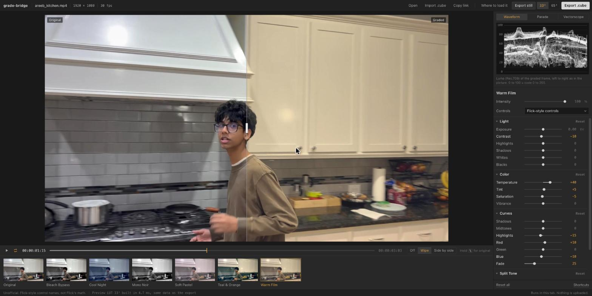
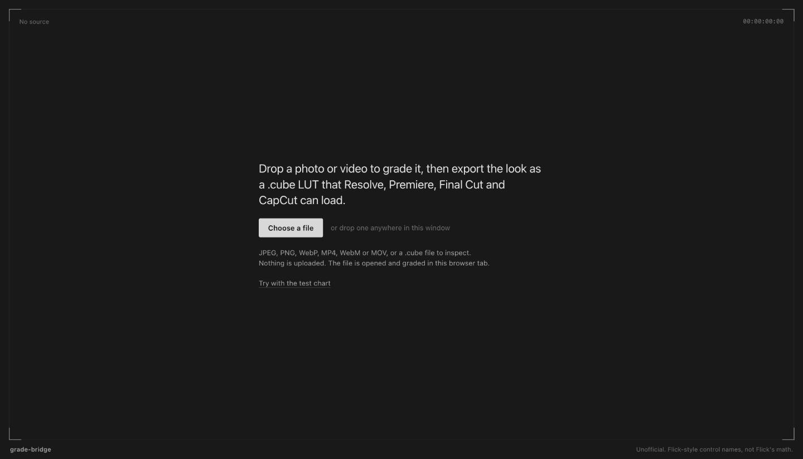
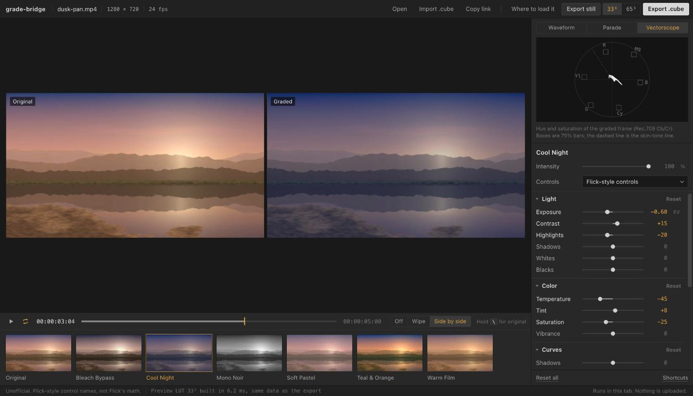
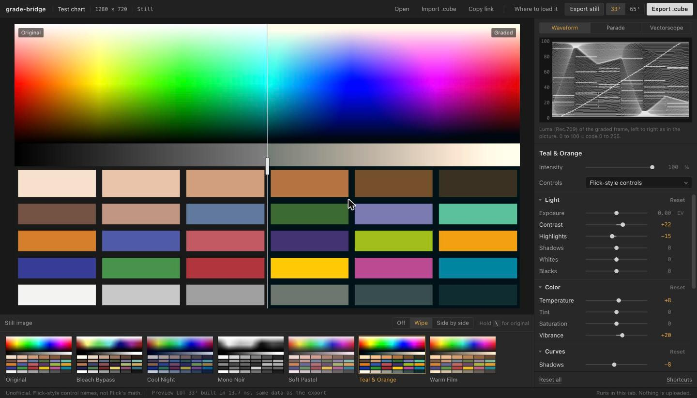
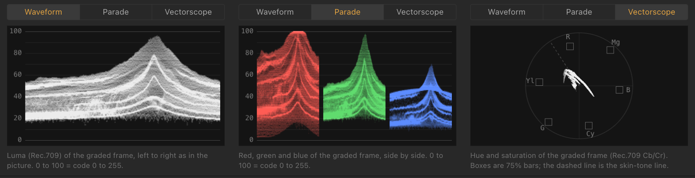
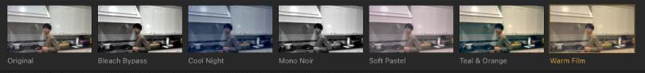
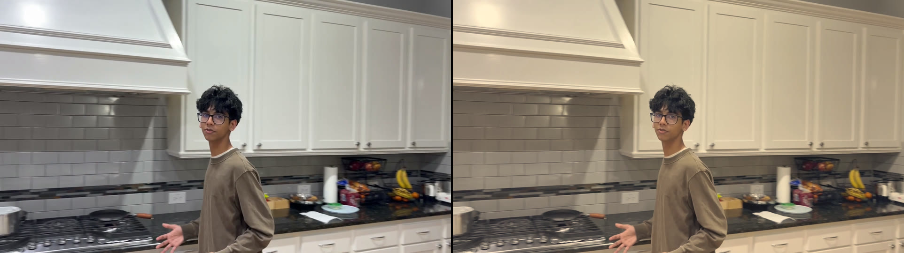
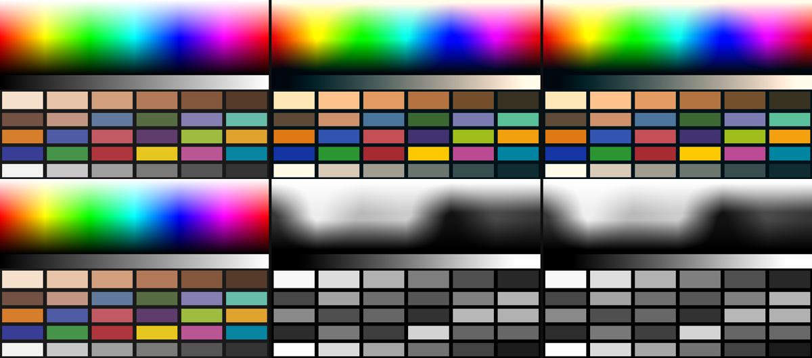

# grade-bridge

When you move an edit from one app to a pro editor through a project file (XML or FCPXML), the cuts and keyframes come across but the color grade does not. grade-bridge exports the grade as a 3D LUT (`.cube` file), which DaVinci Resolve, Premiere Pro, Final Cut Pro, CapCut, OBS and Photoshop can load.

**Limit to know up front:** the Flick adapter uses the control names from Flick's public docs, not Flick's internal color math. A look built here will not match Flick pixel for pixel. Flick could get an exact match by passing its own grade function to `buildLut`, which is about ten lines of code (see "Exact match for an app's own grade" below).



## What it does

- Opens a photo or a short video in the browser. Nothing is uploaded; the file is read and graded in the tab.
- Shows every preset as a thumbnail of your own frame, rendered through that preset's LUT. Click one to apply it.
- Has an Intensity control (0 to 100%) that blends the graded picture with the original. The exported `.cube` has the same blend baked in, and its title says "Mixed at N% intensity".
- Plays video with the grade applied to every frame: play/pause, loop, a scrubber, frame stepping and timecode.
- Draws a luma waveform, an RGB parade and a vectorscope from the graded frame. They update while you drag a slider and about 11 times a second during playback.
- Compares the grade with the original as a wipe, side by side, or by holding `\`.
- Exports a 33³ or 65³ `.cube`, or a full-resolution graded PNG of the current frame ("Export still").
- Builds the grade from one color pipeline and small per-app **adapters** that map an app's slider names onto it. Three adapters are included: Flick-style controls, Lightroom-style photo-editor controls, and lift/gamma/gain primaries.
- Imports any 3D `.cube` to inspect it on your footage, and stores the grade in the URL so a look can be shared as a link.
- Includes a CLI for scripted exports.

The preview, the look thumbnails, the scopes and the export all read the same LUT data. The preview is a WebGL2 3D texture made from that data; against the exact math on 4,096 random colors per preset it is off by a mean of 0.03 to 0.07 levels, max 3 (8-bit). Also measured in Chrome on a 1920x1080 frame at 60% intensity: the exported still and the exported 65³ `.cube` (applied on the CPU) agree within 0.56 of a level, mean 0.24 (8-bit). The shader's intensity mix and the baked-in mixed LUT, both rendered on the GPU, agree within 1 level.

| | |
| --- | --- |
|  |  |
|  |  |



All screenshots use the built-in test chart or procedurally generated media.

Pipeline order: exposure and white balance in linear light, then contrast around a pivot, highlights/shadows, ASC CDL slope/offset/power, then saturation and vibrance (Rec.709 luma), split tone, monotone curves (Fritsch-Carlson), black point, fade, and finally a clamp to 0..1.

## Where to load the file

| Editor | Where |
| --- | --- |
| DaVinci Resolve | Color page, right-click a node > LUTs |
| Premiere Pro | Lumetri Color > Creative > Look > Browse |
| Final Cut Pro | Effects > Color > Custom LUT |
| CapCut (desktop) | Adjust > LUT > Import |
| OBS Studio | Source > Filters > Apply LUT |
| Photoshop | Color Lookup adjustment layer > 3DLUT File |

These menu paths are from each app's documentation. The app shows the same table under "Where to load it". The files were tested in ffmpeg only, not opened in these apps (see "Not verified" below). The LUT expects normal display-referred sRGB / Rec.709 footage, not log or HDR.

## Quickstart

```bash
npm install
npm run dev       # app at http://localhost:5173
npm test          # 82 unit tests
npm run verify    # export presets, apply them with ffmpeg, compare (needs ffmpeg)
npm run build     # static app in dist/, CLI in dist-node/
```

Needs Node 22.18 or newer, because the scripts run TypeScript directly. `npm run verify` also needs `ffmpeg` on your PATH.

## CLI

```bash
npm run build
node dist-node/cli.js export presets/teal-orange.json -o teal-orange.cube
node dist-node/cli.js export presets/warm-film.json -o warm.cube --size 65
node dist-node/cli.js export my-look.json --adapter generic
```

Installed as a package, the command is `grade-bridge`. A preset is JSON in one adapter's control names:

```json
{
  "name": "Teal & Orange",
  "adapter": "flick",
  "values": { "contrast": 22, "splitShadowHue": 190, "splitShadowAmount": 50 }
}
```

An unknown control name is an error, so a typo cannot silently change the look.

## Adapters

```
app sliders --adapter.toParams()--> GradeParams --buildLut()--> Float32Array --> .cube file
                                                                             --> WebGL2 preview
```

Everything to the right of the adapter is shared. Adding an app means writing one file that lists its controls and a `toParams` function. The Flick adapter is about 90 lines and the lift/gamma/gain one is about 50. The steps are in [`src/adapters/README.md`](src/adapters/README.md). The tests check every registered adapter automatically: control keys must be unique, ranges must make sense, and all defaults must produce an identity LUT.

### Exact match for an app's own grade

If an app already has a per-pixel color function, it does not need an adapter. It can fill the LUT grid directly:

```ts
for (let b = 0, i = 0; b < n; b++)
  for (let g = 0; g < n; g++)
    for (let r = 0; r < n; r++, i += 3)
      data.set(appGrade(r / (n - 1), g / (n - 1), b / (n - 1)), i);
// then serializeCube({ size: n, data, domainMin: [0,0,0], domainMax: [1,1,1] }, "Look")
```

This works for any grade that only looks at one pixel's color.

## Verification

`npm run verify` draws a test chart (hue sweep, grey ramp, skin-tone swatches, 24 color patches) and exports each preset to a 33³ `.cube`. ffmpeg's `lut3d` filter then grades the chart from that file, grade-bridge grades it again with its exact math, and the script compares the two results. Real output (ffmpeg 8.1.2, 768x512 chart, 393,216 pixels, errors in 8-bit levels):

| Preset | Adapter | Mean error R / G / B | Max error R / G / B | Max vs JS LUT sampler | Result |
| --- | --- | --- | --- | --- | --- |
| Bleach Bypass | flick | 0.404 / 0.390 / 0.385 | 1 / 2 / 1 | 1 | PASS |
| Cool Night | flick | 0.409 / 0.545 / 0.490 | 1 / 1 / 1 | 1 | PASS |
| Mono Noir | flick | 0.539 / 0.539 / 0.539 | 2 / 2 / 2 | 1 | PASS |
| Soft Pastel | generic | 0.511 / 0.475 / 0.395 | 2 / 2 / 2 | 1 | PASS |
| Teal & Orange | flick | 0.356 / 0.499 / 0.570 | 4 / 2 / 4 | 1 | PASS |
| Warm Film | flick | 0.433 / 0.591 / 0.534 | 3 / 1 / 1 | 1 | PASS |

To pass, the mean must be under 1.5 levels and the max at most 6 levels on every channel. The mean of about half a level comes from 8-bit rounding. The "vs JS LUT sampler" column compares ffmpeg with our own LUT lookup; a max of 1 means ffmpeg reads the file exactly as it was written.

**Negative control:** the script also writes the same LUT with its axes swapped, which is the most common `.cube` bug. That file is off by a mean of 35.0 levels (max 137), which shows the check can fail.

### On real footage

The same check on a real clip: an iPhone video (converted to SDR), graded by ffmpeg from a 65³ Warm Film `.cube` exported by the CLI. Left is the original frame, right is ffmpeg applying the file. This is the path an editor takes, with ffmpeg standing in for it.



### Test chart

Top: Teal & Orange. Bottom: Mono Noir. Each row is original | ffmpeg with the exported `.cube` | exact math:



## Using the app

| Key | Action |
| --- | --- |
| Space | Play or pause |
| Left / Right | Step one frame (Shift: one second) |
| L | Loop on or off |
| `\` held | Show the original |
| C | Compare: off, wipe, side by side |
| [ and ] | Previous or next look |
| S | Next scope |
| E / Shift+E | Export .cube / export still |
| O / I | Open media / import .cube |
| Shift+R | Reset all controls |
| ? | Shortcut sheet |

Drag a value sideways to scrub it (Shift is 10x, Alt is 1/10). Click it to type a number. Double-click a slider or its label to reset it.

### The scopes

- **Waveform**: each column of the scope is the matching column of the picture, and the height is luma (Rec.709 weights). 0 is black (code 0) and 100 is white (code 255). The levels are binned at 128 steps, about 0.8 of a unit each.
- **Parade**: the same plot for red, green and blue, side by side.
- **Vectorscope**: each pixel's hue and saturation, using the Rec.709 color-difference signals (Cb across, Cr up). The six boxes are the 75% color-bar targets and the dashed line is the skin-tone line at 123 degrees.

The scopes are computed from a 640x360 copy of the graded frame, graded on the CPU through the same LUT as the preview. Their binning math is unit tested (`tests/web.test.ts`).

## Limits

- **A LUT only carries color.** It maps each input color to one output color. Anything that looks at neighbouring pixels, position or time cannot go in a LUT: blur, glow, grain, sharpening, vignettes, keying, transitions. Those need the destination editor's own effects.
- **SDR only. iPhone HDR video looks wrong in the browser.** iPhones record HDR (HLG) by default. Browsers pass that footage to WebGL without a reliable HDR to Rec.709 conversion, so it shows up colder and flatter than it really is, and a Rec.709 `.cube` won't match on it in an editor either. The app reads the file's color tags (the `colr` box inside `moov`) and shows a notice when a clip is HLG or PQ. To grade iPhone footage, turn off Settings > Camera > Record Video > HDR Video, or convert an SDR copy first (on a Mac: `avconvert -s in.mov -o out.mov -p PresetHighestQuality`).
- **Display-referred.** Values pushed past white clip, as they do in phone editors.
- **Adapters approximate.** Slider names and ranges inside Flick's Light/Color/Curves sections are not in Flick's docs, so they are conventional guesses.
- **Video is preview only.** You export the `.cube` and render the video in your editor. Playback is muted, and the browser decides which codecs it can open (H.264 MP4 and WebM work in Chrome; ProRes and most log camera files do not).
- **Timecode is measured, not read from the file.** The browser does not report a video's frame rate, so the app measures it during the first few frames of playback and snaps it to a standard rate. Until then the timecode shows milliseconds. Drop-frame timecode is not supported.
- **Scopes are of a 640x360 copy**, not the full-resolution frame, so single-pixel detail can be missed.

## Not verified

- The `.cube` files have not been opened in Resolve, Premiere, Final Cut, CapCut, OBS or Photoshop. They are tested only in ffmpeg.
- The app was checked in desktop Chrome on macOS at 1440 and 1280 wide, and at 390 wide in a resized frame. It has not been checked in Safari or Firefox, or on a real phone.

## Not affiliated

This is an independent, unofficial project. It is not affiliated with or endorsed by Flick, Adobe, Apple, Blackmagic Design, ByteDance (CapCut) or the OBS Project. The "Flick-style controls" adapter only reuses control names from Flick's public documentation and uses none of Flick's code, logos or branding. Product names are trademarks of their owners.

## License

MIT. See [LICENSE](LICENSE).
