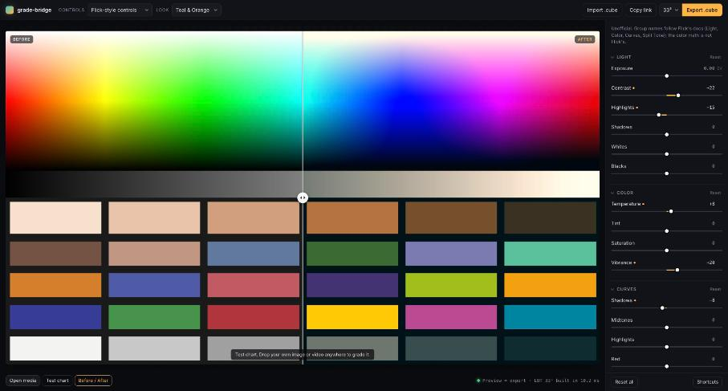

# grade-bridge

When you move an edit from one app to a pro editor through a project file (XML or FCPXML), the cuts and keyframes come across but the color grade does not. grade-bridge exports the grade as a 3D LUT (`.cube` file), which DaVinci Resolve, Premiere Pro, Final Cut Pro, CapCut, OBS and Photoshop can load.

**Limit to know up front:** the Flick adapter uses the control names from Flick's public docs, not Flick's internal color math. A look built here will not match Flick pixel for pixel. Flick could get an exact match by passing its own grade function to `buildLut`, which is about ten lines of code (see "Exact match for an app's own grade" below).



_GIF placeholder: a short screen recording of dragging a slider and exporting._

## What it does

- Builds a 33³ or 65³ `.cube` from a set of slider values. The file has `TITLE`, `LUT_3D_SIZE`, `DOMAIN_MIN`, `DOMAIN_MAX`, with red changing fastest.
- Uses one color pipeline and small per-app **adapters** that map an app's slider names onto it. Three adapters are included: Flick-style controls, Lightroom-style photo-editor controls, and lift/gamma/gain primaries.
- Includes a browser app with drag-and-drop for images, short videos or `.cube` files, a before/after split, grouped sliders, six presets, Import `.cube`, Export `.cube`, and share links (the grade is stored in the URL hash and nothing is uploaded).
- Shows a preview built from the same LUT array the export writes, uploaded to a WebGL2 3D texture. Measured against the exact math in Chrome on 4,096 random colors per preset: mean error 0.03 to 0.07 levels, max 3 levels (8-bit).
- Includes a CLI for scripted exports.

Pipeline order: exposure and white balance in linear light, then contrast around a pivot, highlights/shadows, ASC CDL slope/offset/power, then saturation and vibrance (Rec.709 luma), split tone, monotone curves (Fritsch-Carlson), black point, fade, and finally a clamp to 0..1.

## Where to load the file

| Editor | Where |
| --- | --- |
| DaVinci Resolve | Color page, right-click a node > LUTs |
| Premiere Pro | Lumetri Color > Creative > Look > Browse |
| Final Cut Pro | Effects > Color > Custom LUT |
| CapCut (desktop) | Adjust > LUT > Import |
| OBS Studio | Source > Filters > Apply LUT |
| Photoshop | Color Lookup adjustment layer > 3DLUT File |

These menu paths are from each app's documentation. The files were tested in ffmpeg only, not opened in these apps (see "Not verified" below). The LUT expects normal display-referred sRGB / Rec.709 footage, not log or HDR.

## Quickstart

```bash
npm install
npm run dev       # app at http://localhost:5173
npm test          # 61 unit tests
npm run verify    # export presets, apply them with ffmpeg, compare (needs ffmpeg)
npm run build     # static app in dist/, CLI in dist-node/
```

Needs Node 22.18 or newer, because the scripts run TypeScript directly. `npm run verify` also needs `ffmpeg` on your PATH.

## CLI

```bash
npm run build
node dist-node/cli.js export presets/teal-orange.json -o teal-orange.cube
node dist-node/cli.js export presets/warm-film.json -o warm.cube --size 65
node dist-node/cli.js export my-look.json --adapter generic
```

Installed as a package, the command is `grade-bridge`. A preset is JSON in one adapter's control names:

```json
{
  "name": "Teal & Orange",
  "adapter": "flick",
  "values": { "contrast": 22, "splitShadowHue": 190, "splitShadowAmount": 50 }
}
```

An unknown control name is an error, so a typo cannot silently change the look.

## Adapters

```
app sliders --adapter.toParams()--> GradeParams --buildLut()--> Float32Array --> .cube file
                                                                             --> WebGL2 preview
```

Everything to the right of the adapter is shared. Adding an app means writing one file that lists its controls and a `toParams` function. The Flick adapter is about 90 lines and the lift/gamma/gain one is about 50. The steps are in [`src/adapters/README.md`](src/adapters/README.md). The tests check every registered adapter automatically: control keys must be unique, ranges must make sense, and all defaults must produce an identity LUT.

### Exact match for an app's own grade

If an app already has a per-pixel color function, it does not need an adapter. It can fill the LUT grid directly:

```ts
for (let b = 0, i = 0; b < n; b++)
  for (let g = 0; g < n; g++)
    for (let r = 0; r < n; r++, i += 3)
      data.set(appGrade(r / (n - 1), g / (n - 1), b / (n - 1)), i);
// then serializeCube({ size: n, data, domainMin: [0,0,0], domainMax: [1,1,1] }, "Look")
```

This works for any grade that only looks at one pixel's color.

## Verification

`npm run verify` draws a test chart (hue sweep, grey ramp, skin-tone swatches, 24 color patches) and exports each preset to a 33³ `.cube`. ffmpeg's `lut3d` filter then grades the chart from that file, grade-bridge grades it again with its exact math, and the script compares the two results. Real output (ffmpeg 8.1.2, 768x512 chart, 393,216 pixels, errors in 8-bit levels):

| Preset | Adapter | Mean error R / G / B | Max error R / G / B | Max vs JS LUT sampler | Result |
| --- | --- | --- | --- | --- | --- |
| Bleach Bypass | flick | 0.404 / 0.390 / 0.385 | 1 / 2 / 1 | 1 | PASS |
| Cool Night | flick | 0.409 / 0.545 / 0.490 | 1 / 1 / 1 | 1 | PASS |
| Mono Noir | flick | 0.539 / 0.539 / 0.539 | 2 / 2 / 2 | 1 | PASS |
| Soft Pastel | generic | 0.511 / 0.475 / 0.395 | 2 / 2 / 2 | 1 | PASS |
| Teal & Orange | flick | 0.356 / 0.499 / 0.570 | 4 / 2 / 4 | 1 | PASS |
| Warm Film | flick | 0.433 / 0.591 / 0.534 | 3 / 1 / 1 | 1 | PASS |

To pass, the mean must be under 1.5 levels and the max at most 6 levels on every channel. The mean of about half a level comes from 8-bit rounding. The "vs JS LUT sampler" column compares ffmpeg with our own LUT lookup; a max of 1 means ffmpeg reads the file exactly as it was written.

**Negative control:** the script also writes the same LUT with its axes swapped, which is the most common `.cube` bug. That file is off by a mean of 35.0 levels (max 137), which shows the check can fail.

Top: Teal & Orange. Bottom: Mono Noir. Each row is original | ffmpeg with the exported `.cube` | exact math:


## Limits

- **A LUT only carries color.** It maps each input color to one output color. Anything that looks at neighbouring pixels, position or time cannot go in a LUT: blur, glow, grain, sharpening, vignettes, keying, transitions. Those need the destination editor's own effects.
- **Display-referred.** Values pushed past white clip, as they do in phone editors.
- **Adapters approximate.** Slider names and ranges inside Flick's Light/Color/Curves sections are not in Flick's docs, so they are conventional guesses.
- **Video is preview only.** You export the `.cube` and render the video in your editor.

## Not verified

- The `.cube` files have not been opened in Resolve, Premiere, Final Cut, CapCut, OBS or Photoshop. They are tested only in ffmpeg.
- The app was checked in desktop Chrome on macOS. It has not been checked in Safari or Firefox, or on a phone.

## Not affiliated

This is an independent, unofficial project. It is not affiliated with or endorsed by Flick, Adobe, Apple, Blackmagic Design, ByteDance (CapCut) or the OBS Project. The "Flick-style controls" adapter only reuses control names from Flick's public documentation and uses none of Flick's code, logos or branding. Product names are trademarks of their owners.

## License

MIT. See [LICENSE](LICENSE).
